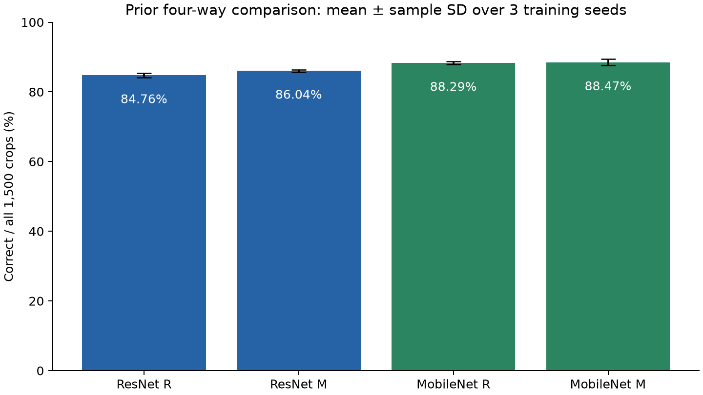
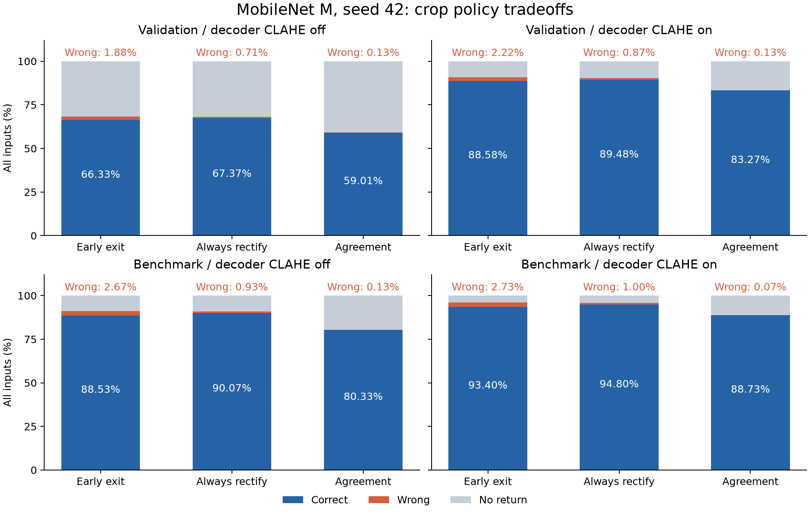
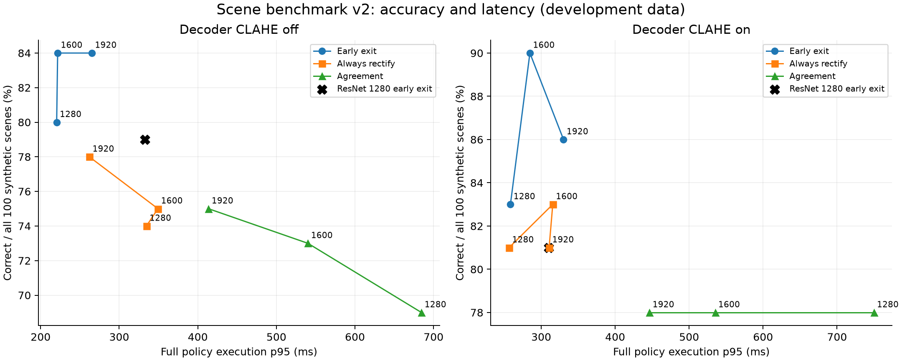

# 최종 판단과 공유용 요약

백본은 **MobileNet M, seed42, epoch90**을 유지한다. 운영 후보 두 가지를 유지한다.
M: lr 3e-4, batch 64, 100 epoch 학습, β=1/154. 검증 기준 선택은 epoch90이다.
새 학습 없이 기존 선택 체크포인트로 추가 실험했다.

아래 두 후보를 별도의 운영 검증 조건으로 유지한다.

아래는 합성 장면 100개에서 관찰한 결과다. 오독률은 전체 입력 대비 비율이다.

| 후보 | 설정 | 정답 | 오독 | 무응답 | p50 / p95(ms) |
| --- | --- | --- | --- | --- | --- |
| 오독 억제 우선 | imgsz 1280 · CLAHE on · 항상 보정 | 81 | 0 | 19 | 98.48 / 256.50 |
| 정답률 우선 | imgsz 1600 · CLAHE on · 현재 조기 종료 | 90 | 4 | 6 | 66.39 / 284.70 |

정책·해상도는 이 개발 결과에서 고른 후보이며, 독립 test로 검증된 배포 설정은 아니다.
특히 100개에서 오독 0개를 관찰해도 실제 오독 위험이 0이라고 판단할 수 없다.

## crop에서 확인한 정책 효과

CLAHE benchmark 1,500개에서 항상 보정은 현재 정책 대비 정답률 93.40%→94.80%, 오독률 2.73%→1.00%였다.
일치 확인은 오독 1/1,500개로 줄었지만 무응답 168개(11.20%)를 만들었다.
crop 결과와 전체 장면 결과를 구분했다. 탐지 crop에서는 강제 보정의 손실도 있었다.
기존 네 조건은 3개 seed의 평균±표준편차, 후속 실험은 단일 체크포인트 결과다.
MobileNet은 공통 head를 적용한 새 후보다. 과거 보고서 모델의 정확한 재현은 아니다.
CLAHE와 백본 효과를 분리한다. MobileNet이 항상 더 빠르다고 결론내리지 않는다.

## 완료 및 검증

정확도 12개, 시간 측정 10개가 모두 완료됐다.
각 시간 작업은 50회 warmup 후 세 정책을 전체 입력에서 각각 3회 반복했다.
측정에는 판독 추적·이미지 hash를 포함한다. 모델 로딩·파일 I/O·UI는 제외한다.
항상 보정은 D0 판독을 생략한다. 일치 확인은 D0와 세 warp를 모두 실행한다.
CPU 대조 8개 장면 조건×100개 판독이 일치했다. 기록된 detector/model 출력을 사용한 검사이며 GPU 재추론으로 표현하지 않는다.
W&B 평가/시간 작업 22개의 finished 상태와 artifact 파일 digest를 확인했다. 원본·코드·수정 기록 보존 검사 202건이 통과했다.
최종 코드 검사: pytest 342 passed, 11 skipped; ruff check/format 및 import-linter 4개 계약 통과.
실행 중 native 대조 설정 수정과 실패 로그는 EXECUTION_ko.md에 공개했다.

[통합 W&B 결과](https://wandb.ai/kim-1034/wemeet-barcode/runs/6l7wobm3) · [독립 최종 검증](https://wandb.ai/kim-1034/wemeet-barcode/runs/9exj2n9t)

## 공유 파일

Notion에는 NOTION_ko.md를 사용한다. 전체 수치·실패 샘플·재현 설명은 같은 폴더에 있다.
GitHub 브랜치는 ai/mobilenet-followup-20261027이다. 원격 게시 여부는 별도 확인한다.
가중치와 데이터는 GitHub에 넣지 않고 고정된 HF revision 및 W&B artifact로 연결한다.

---

# MobileNet 선정 및 후속 실험 통합 결과

기존 네 조건의 3-seed 비교와, 선택한 MobileNet M/seed42의 후속 평가를 함께 정리했다.
추가 학습 없이 GPU 6·7(A100 40GB)을 사용했다. 후속 결과는 단일 체크포인트의 개발셋 평가다.

## 1. 기존 네 조건 비교

R: lr 1e-4, batch 8, 50 epoch, β=0.02. M: lr 3e-4, batch 64, 100 epoch, β=1/154.
동일한 공통 head·데이터 분할로 각 모델에 R/M을 적용했다. 아래는 seed42/43/44 평균 ± 표준편차(%).

| 모델 | 조건 | 검증 정답률 | 검증 오독률 | benchmark 정답률 | benchmark 오독률 |
| --- | --- | --- | --- | --- | --- |
| resnet18-c3 | R | 63.81 ± 0.24 | 1.87 ± 0.19 | 84.76 ± 0.68 | 2.87 ± 0.29 |
| resnet18-c3 | M | 64.36 ± 0.29 | 1.86 ± 0.05 | 86.04 ± 0.38 | 2.64 ± 0.14 |
| mobilenetv3-small | R | 65.28 ± 0.19 | 1.95 ± 0.15 | 88.29 ± 0.43 | 2.58 ± 0.23 |
| mobilenetv3-small | M | 66.12 ± 0.29 | 1.86 ± 0.04 | 88.47 ± 0.90 | 2.56 ± 0.38 |

MobileNet M을 채택하고 검증 RR_H 기준으로 seed42/epoch90을 선택했다(100 epoch 학습).
이전 ResNet 채택 당시의 서로 다른 데이터·지표로 나온 수치는 이번 공통 조건 비교와 직접 비교할 수 없다.
MobileNet의 평균 정답률 우위와 모든 조건에서의 오독률 우위는 별개의 주장이다.

[기존 W&B 통합 결과](https://wandb.ai/kim-1034/wemeet-barcode/runs/n13l9dno) · [기존 상세 보고서](../2026-10-26-stage2-controlled-v2/REPORT_ko.md)

## 2. 후속 실험 조건

1. 정책: 현재 조기 종료 / 항상 보정 / 판독 일치 확인을 동일 입력에서 비교했다.
2. Full pipeline: 탐지→crop→D0→geometry→TPS→1/1.5/3배 재시도를 평가했다.
3. 탐지 입력 해상도: MobileNet 1280/1600/1920, ResNet M 대조군 1280을 사용했다.
4. 오독·미검출·무응답을 나누고, 난도·형태·기울기별 결과와 실제 실패 샘플을 저장했다.

일치 확인은 D0와 세 warp에서 서로 다른 이미지 2개 이상이 같은 text/format을 반환하고,
다른 유효 판독이 없을 때만 채택한다. GT는 판독 결정에 쓰지 않는다. 동일한 오독이 반복되면 통과할 수 있다.
항상 보정은 D0를 채택하지 않고, 첫 유효 warp 판독을 사용한다.

최신 GitHub 디코더의 CLAHE 재시도(clip=4, grid=4×4) 효과를 분리하기 위해 off/on을 각각 평가했다.
zxing-cpp 단일 백엔드, FP32, TF32 off, CPU thread 1. 탐지 전 CLAHE는 양쪽 모두 동일하게 적용했다.

## 3. MobileNet crop 판독 정책

각 셀은 정답률 / 오독률 / 무응답률(%). C/W/U는 서로 배타적이며 분모는 전체 입력 수다.

| 데이터 | 디코더 CLAHE | 현재 조기 종료 | 항상 보정 | 판독 일치 확인 |
| --- | --- | --- | --- | --- |
| validation (n=2976) | legacy | 66.33 / 1.88 / 31.79 | 67.37 / 0.71 / 31.92 | 59.01 / 0.13 / 40.86 |
| validation (n=2976) | clahe | 88.58 / 2.22 / 9.21 | 89.48 / 0.87 / 9.64 | 83.27 / 0.13 / 16.60 |
| benchmark (n=1500) | legacy | 88.53 / 2.67 / 8.80 | 90.07 / 0.93 / 9.00 | 80.33 / 0.13 / 19.53 |
| benchmark (n=1500) | clahe | 93.40 / 2.73 / 3.87 | 94.80 / 1.00 / 4.20 | 88.73 / 0.07 / 11.20 |

legacy는 기존 디코더 조건(off), clahe는 최신 디코더 조건(on)이다.
기존 조건의 4,476개 입력 모두에서 원래 예측과 판독 결과를 재현 검사했다.

## 4. 전체 파이프라인 및 탐지 해상도

benchmark/v2의 합성 장면 100개. 각 셀은 정답률 / 오독률 / 무응답률(%).

| 모델 | imgsz | 디코더 CLAHE | 탐지 수 | 현재 조기 종료 | 항상 보정 | 판독 일치 확인 |
| --- | --- | --- | --- | --- | --- | --- |
| resnet18-c3 | 1280 | False | 92 | 79.00 / 1.00 / 20.00 | 74.00 / 1.00 / 25.00 | 71.00 / 0.00 / 29.00 |
| mobilenetv3-small | 1280 | False | 92 | 80.00 / 0.00 / 20.00 | 74.00 / 0.00 / 26.00 | 69.00 / 0.00 / 31.00 |
| mobilenetv3-small | 1600 | False | 99 | 84.00 / 4.00 / 12.00 | 75.00 / 4.00 / 21.00 | 73.00 / 0.00 / 27.00 |
| mobilenetv3-small | 1920 | False | 99 | 84.00 / 1.00 / 15.00 | 78.00 / 1.00 / 21.00 | 75.00 / 0.00 / 25.00 |
| resnet18-c3 | 1280 | True | 92 | 81.00 / 2.00 / 17.00 | 78.00 / 1.00 / 21.00 | 73.00 / 0.00 / 27.00 |
| mobilenetv3-small | 1280 | True | 92 | 83.00 / 1.00 / 16.00 | 81.00 / 0.00 / 19.00 | 78.00 / 0.00 / 22.00 |
| mobilenetv3-small | 1600 | True | 99 | 90.00 / 4.00 / 6.00 | 83.00 / 4.00 / 13.00 | 78.00 / 0.00 / 22.00 |
| mobilenetv3-small | 1920 | True | 99 | 86.00 / 4.00 / 10.00 | 81.00 / 3.00 / 16.00 | 78.00 / 0.00 / 22.00 |

탐지 수는 박스 반환 횟수이며 mAP가 아니다. A=전체 이미지 직접 판독, B=탐지 crop D0,
C=B에서 판독 실패 시 1배 warp, D=현재 조기 종료의 3개 scale 재시도다.
A/B/C/D의 상세 수치는 results.csv에 포함했다.

## 5. 실제 실행 시간

모든 정확도 평가가 끝난 뒤 시간 측정을 직렬로 실행했다. 50회 warmup 후 전체 입력을 3회 반복했다.
셀은 반복별 p50/p95의 중앙값(ms)이다. crop은 탐지 제외, scene은 탐지를 포함한다.
모델·입력을 메모리에 올린 뒤 측정하므로 시작 시 로딩, 파일 I/O, 네트워크 시간은 제외한다.

| 작업 | 현재 조기 종료 | 항상 보정 | 판독 일치 확인 |
| --- | --- | --- | --- |
| crop-benchmark-legacy | 29.75 / 140.54 | 26.07 / 126.88 | 92.18 / 304.66 |
| scene-resnet18-c3-1280-legacy | 65.05 / 332.63 | 98.55 / 377.22 | 224.15 / 629.04 |
| scene-mobilenetv3-small-1280-legacy | 67.38 / 220.40 | 104.79 / 334.62 | 234.28 / 684.64 |
| scene-mobilenetv3-small-1600-legacy | 70.49 / 221.66 | 112.81 / 349.28 | 226.99 / 540.14 |
| scene-mobilenetv3-small-1920-legacy | 71.52 / 265.16 | 106.93 / 262.03 | 214.33 / 413.65 |
| crop-benchmark-clahe | 27.90 / 133.53 | 26.67 / 124.47 | 109.39 / 352.64 |
| scene-resnet18-c3-1280-clahe | 67.65 / 310.14 | 99.15 / 503.31 | 228.55 / 648.81 |
| scene-mobilenetv3-small-1280-clahe | 64.64 / 258.37 | 98.48 / 256.50 | 233.11 / 749.81 |
| scene-mobilenetv3-small-1600-clahe | 66.39 / 284.70 | 100.16 / 315.62 | 229.39 / 535.24 |
| scene-mobilenetv3-small-1920-clahe | 67.99 / 330.15 | 102.30 / 310.67 | 216.58 / 446.36 |

## 6. 실패 분석 및 해석 범위

failure_cases.csv에는 모든 오독·무응답의 ID, GT, 판독값, D0 상태, 난도와 형태를 기록했다.
failure_summary.csv는 원인 후보별 건수다. 판독 불일치/부족과 미검출을 별도로 구분한다.
보정 이후 오독은 관찰된 위치를 뜻하며, TPS나 모델이 원인이라고 단정하는 진단은 아니다.
원시 추론·warp 판독, 난도별 집계, 좌표 오차, D0→최종 전이는 W&B artifact 및 summary.json에 있다.

paired_comparisons.json에는 동일 입력 간 정답 증가/감소와 오독률 차이를 넣었다.
95% 구간은 payload 텍스트를 묶은 paired bootstrap 2,000회이며, 다중 비교 보정은 하지 않았다.
텍스트는 실제 원본 장면 ID의 대용치이므로 독립성을 완전히 보장하지 않는다.

검증 2,976개는 체크포인트 선택에 사용했고 crop benchmark 1,500개와 장면 100개는 합성 개발셋이다.
학습과 payload가 겹칠 수 있어 독립 test/현장 일반화 성능으로 제시하지 않는다.
이 실험에서 정책을 선택한 뒤에는 별도의 실물 바코드 holdout에서 최종 확인해야 한다.

## 7. 재현과 공유

기반 GitHub commit: `f449b9c34df3a42c5c324a0629b0dbee3308f1b3`.
장면 dataset revision: `41bd506fa5e9a5aac33f202d2f9ce98acc77d4f3`.
MobileNet checkpoint SHA256: `1129538deba96ca23b8e31b2be12a18e030d75d495a480aeb7dd695584306e96`.
패키지·가중치·GPU 식별 정보는 provenance.json, 검증 결과는 validation.json에 있다.
GitHub에는 코드·문서·집계를 공유하고, 데이터/가중치/전체 trace는 W&B artifact와 고정 HF revision으로 연결한다.
기존 캠페인과 결과 파일은 수정하지 않았다. README.md에 실행 방법을 정리했다.

| 실험 | W&B |
| --- | --- |
| crop-validation-legacy | [run](https://wandb.ai/kim-1034/wemeet-barcode/runs/z57vfgpx) |
| crop-benchmark-legacy | [run](https://wandb.ai/kim-1034/wemeet-barcode/runs/ocanwzzf) |
| scene-resnet18-c3-1280-legacy | [run](https://wandb.ai/kim-1034/wemeet-barcode/runs/k0wl3rfl) |
| scene-mobilenetv3-small-1280-legacy | [run](https://wandb.ai/kim-1034/wemeet-barcode/runs/ympn947r) |
| scene-mobilenetv3-small-1600-legacy | [run](https://wandb.ai/kim-1034/wemeet-barcode/runs/2rzr9ovj) |
| scene-mobilenetv3-small-1920-legacy | [run](https://wandb.ai/kim-1034/wemeet-barcode/runs/20orgz5e) |
| crop-validation-clahe | [run](https://wandb.ai/kim-1034/wemeet-barcode/runs/3tjm6v63) |
| crop-benchmark-clahe | [run](https://wandb.ai/kim-1034/wemeet-barcode/runs/jus1fj03) |
| scene-resnet18-c3-1280-clahe | [run](https://wandb.ai/kim-1034/wemeet-barcode/runs/adkme6mk) |
| scene-mobilenetv3-small-1280-clahe | [run](https://wandb.ai/kim-1034/wemeet-barcode/runs/p3qc0lkm) |
| scene-mobilenetv3-small-1600-clahe | [run](https://wandb.ai/kim-1034/wemeet-barcode/runs/iaknpims) |
| scene-mobilenetv3-small-1920-clahe | [run](https://wandb.ai/kim-1034/wemeet-barcode/runs/qrsc91f5) |
| crop-benchmark-legacy-timing | [run](https://wandb.ai/kim-1034/wemeet-barcode/runs/tirizmfn) |
| scene-resnet18-c3-1280-legacy-timing | [run](https://wandb.ai/kim-1034/wemeet-barcode/runs/9ucsgmcy) |
| scene-mobilenetv3-small-1280-legacy-timing | [run](https://wandb.ai/kim-1034/wemeet-barcode/runs/4dwcjc5m) |
| scene-mobilenetv3-small-1600-legacy-timing | [run](https://wandb.ai/kim-1034/wemeet-barcode/runs/9u06gpqu) |
| scene-mobilenetv3-small-1920-legacy-timing | [run](https://wandb.ai/kim-1034/wemeet-barcode/runs/rhjdfxfd) |
| crop-benchmark-clahe-timing | [run](https://wandb.ai/kim-1034/wemeet-barcode/runs/gpvcax2b) |
| scene-resnet18-c3-1280-clahe-timing | [run](https://wandb.ai/kim-1034/wemeet-barcode/runs/zokb6wka) |
| scene-mobilenetv3-small-1280-clahe-timing | [run](https://wandb.ai/kim-1034/wemeet-barcode/runs/epqsky2o) |
| scene-mobilenetv3-small-1600-clahe-timing | [run](https://wandb.ai/kim-1034/wemeet-barcode/runs/ff3ptw6o) |
| scene-mobilenetv3-small-1920-clahe-timing | [run](https://wandb.ai/kim-1034/wemeet-barcode/runs/bxxhbxai) |

[이번 통합 W&B 보고서](https://wandb.ai/kim-1034/wemeet-barcode/runs/6l7wobm3)

---

# 기존 네 조건의 시간 측정

seed42 체크포인트, A100, 50회 warmup 후 benchmark 1,500개를 3회 반복했다.
아래 값은 반복별 p50/p95의 중앙값(ms)이다. crop 경로는 탐지(Stage 1)를 제외한다.

| 모델·조건 | Stage 2 p50 / p95 | crop 정책 p50 / p95 | W&B |
|---|---:|---:|---|
| resnet18-c3 R | 2.627 / 3.172 | 29.540 / 168.933 | [run](https://wandb.ai/kim-1034/wemeet-barcode/runs/fxelrsmp) |
| resnet18-c3 M | 2.629 / 3.201 | 28.481 / 161.445 | [run](https://wandb.ai/kim-1034/wemeet-barcode/runs/qeibu49e) |
| mobilenetv3-small R | 4.042 / 4.642 | 29.313 / 153.426 | [run](https://wandb.ai/kim-1034/wemeet-barcode/runs/t1zgj93a) |
| mobilenetv3-small M | 4.155 / 4.883 | 29.184 / 139.255 | [run](https://wandb.ai/kim-1034/wemeet-barcode/runs/ua4zdwkk) |

이 A100 측정에서 MobileNet의 Stage 2 단독 지연시간은 ResNet보다 길었다.
따라서 MobileNet을 경량 모델이라는 이유만으로 더 빠르다고 해석하지 않는다.
MobileNet 채택 근거는 공통 조건에서의 정답률·복원 성능이며, 최종 처리시간은 전체 경로로 따로 확인한다.
이번 후속 실험은 최신 소스의 디코더 CLAHE off/on과 세 정책을 분리했으므로, 예전 crop 수치와 새 수치를 그대로 합쳐 평균내지 않는다.

## 그래프

