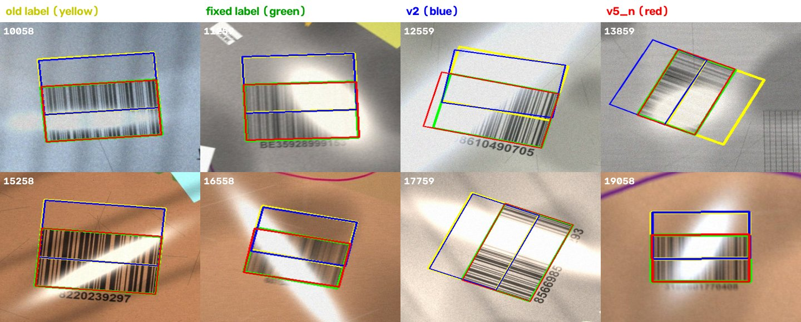

# Stage 1 탐지 재학습 — 합성 v5(1920×1080) 와 정답 박스 버그 · 2026-11-04 ~ 11-07

**결론: 합성 생성기의 정답 박스 버그(`foot_pts[::3]`)를 고치고 1920×1080 으로 새로 만든 데이터(v5)로
학습한 `v5_n` 이, 생성기가 다른 v2 val 에서 박스 위치 성공률 99.9%(현재 배포 v2 는 79.7%)를 냈다.**
같은 버그가 **v2 를 만든 옛 생성기에도 있었다** — 현재 배포된 v2 가중치는 반사광 장면에서
박스를 막대 높이 절반만큼 위로 밀어 그리도록 학습돼 있고, 2026-09-22 기록의 v2 val 숫자도
밀린 정답으로 잰 것이다.

> 전부 합성 데이터다. 실카메라 평가는 아직 없다 (「한계」).
> 가중치(`*.pt`)는 저장소에 넣지 않았다. HF 업로드는 s 학습이 끝난 뒤 따로 한다.

## 배경 — 무엇이 잘못됐었나

v4 계획(흰 라벨 종이·실배경·카메라 열화, 4만 장)으로 `v4_n` 을 CHEETAH 에서 1280 으로 학습했는데
(11/02~04), v2 val 에서 mAP50 0.43 이 나왔다. 원인은 생성기의 정답 박스 계산이었다:

```python
cnts, _ = cv2.findContours(foot, cv2.RETR_EXTERNAL, cv2.CHAIN_APPROX_SIMPLE)
foot_pts = np.vstack(cnts).reshape(-1, 2)[::3]   # 외곽 점을 3개마다 하나씩
```

변형이 없는 직사각형 발자국은 `CHAIN_APPROX_SIMPLE` 이 꼭짓점 4개(왼쪽 위→왼쪽 아래→오른쪽 아래→
오른쪽 위)만 준다. 여기서 `[::3]` 으로 솎으면 0번·3번, 즉 **윗변 두 점만** 남는다. `ratio_box` 는 이 선분을
감싸는 정해진 비율의 상자를 선분 중심에 만들므로, 박스가 **막대 높이 절반만큼 위로 밀린다.**
구겨진(외곽 점이 많은) 발자국은 거의 영향이 없다.
고친 방법은 `cv2.convexHull` 로 외곽 전체를 쓰는 것이다 (v3·v4 생성기 모두).

**같은 줄이 v2 를 만든 옛 생성기(`2026-09-22-stage1-detection/code/make_barcode_dataset.py:781`)에도
있다.** 그 생성기에서 반사광(glare) 장면은 막대를 변형하지 않으므로 전부 이 버그에 걸렸다
(아래 「결과 2」).

## 무엇을 바꿨나

| 파일 | 내용 |
|---|---|
| [`code/make_damaged_barcode_dataset_v3.py`](code/make_damaged_barcode_dataset_v3.py), [`_v4.py`](code/make_damaged_barcode_dataset_v4.py) | 정답 박스를 `convexHull` 로 계산. v4 에 `--height {720,1080}` (화면 픽셀 상수에 `PX = height/720` 을 곱함, 기본 720 은 이전과 같은 그림). 메타에 `label_cover`(발자국 중 박스 안 비율)·`box_fill` 추가 |
| [`code/qa_dataset.py`](code/qa_dataset.py) | 학습 전 데이터 검사 — 형식, `label_cover ≥ 0.98`, 격자 그림, **v2 독립 검사**(박스가 정확한 모델의 예측과 정답의 회전 IoU). 하나라도 실패하면 exit 1 |
| [`code/train_cheetah.py`](code/train_cheetah.py) | `--smoke`(데이터 2%·1 에폭으로 배치·메모리·에폭 시간 측정), W&B 기록 |
| [`code/probe_batch.py`](code/probe_batch.py) | MIG 에서 배치 크기 직접 측정 (AutoBatch 가 죽는 문제, 아래) |
| [`code/run_v5_pipeline.sh`](code/run_v5_pipeline.sh) | 생성 → 검사 → s·n 스모크 → n 36h → s 36h. 단계마다 실패하면 정지 |
| [`code/compare_models.py`](code/compare_models.py) | 모델 비교 (mAP, **회전 IoU 성공률**, benchmark-v2 탐지율) |
| [`code/relabel720.py`](code/relabel720.py) | v2 val 의 정답을 버그 없이 다시 계산 (옛 생성기를 같은 시드로 재현) |

### 검사가 버그를 실제로 잡는지 먼저 확인했다

v2 독립 검사는 생성기와 무관한 기준(v2 모델)으로 본다. 손상 없는 장면에서 IoU ≥ 0.5 비율:

| 데이터 | IoU ≥ 0.5 | IoU 중앙값 |
|---|---|---|
| 버그 있는 v3 (514장) | 0.547 | 0.963 |
| 고친 v5 미리보기 (77장) | 1.000 | 0.945 |
| **v5 본 데이터 (train 735장)** | **0.978** | 0.959 |

중앙값은 둘을 못 가른다 (밀린 박스도 절반은 맞음). **IoU ≥ 0.5 비율로 판정**하고 기준은 0.95 로 뒀다.
v4 생성기의 val 은 복합 손상·twist 만 있어 손상 없는 장면이 0장이므로 train 에서 뽑는다.

## 학습 — CHEETAH A100 MIG 1g.10gb, imgsz 1920

| | v5_n | v5_s |
|---|---|---|
| 시작 가중치 | v2 (`barcode_v2_best.pt`) | `yolo11s-obb.pt` (DOTA) |
| 배치 | 4 (최대 7.3GB) | 2 (6.5GB) |
| 에폭 | 47 (36h, 46분/에폭) | 진행 중 (~25 예상, 86분/에폭) |
| v5 val (4,000장) | mAP50 0.995 · mAP50-95 0.977 | — |

**MIG 에서는 AutoBatch 를 쓰면 안 된다.** 1g.10gb 는 NVML 권한이 없어, 배치를 늘려 보다 메모리가 넘치면
OOM 대신 `NVML_SUCCESS == r INTERNAL ASSERT FAILED` 가 나고, AutoBatch 가 이걸 못 잡아 기본값 16 으로
학습하다 죽는다 (1280 에서는 탐색 중 메모리가 안 넘쳐 드러나지 않았다). `probe_batch.py` 로 재서 고정했다.

## 결과 1 — 고친 v2 val (2,000장, imgsz 1920)

정답을 고친 v2 val 기준. 회전 IoU 성공률 = 가장 확신 높은 박스가 정답과 IoU ≥ 0.5 인 비율 (놓친 장은 실패).

| 모델 | mAP50 | mAP50-95 | IoU ≥ 0.5 | IoU ≥ 0.75 | 놓침 | benchmark-v2 탐지 |
|---|---|---|---|---|---|---|
| v2 (현재 배포) | 0.777 | 0.713 | 79.7% | 74.2% | 15 | 99/100 |
| v4_n (버그) | 0.293 | 0.280 | 44.7% | 44.2% | 31 | 100/100 |
| **v5_n** | **0.995** | **0.986** | **99.9%** | **99.1%** | **1** | 99/100 |

benchmark-v2 는 박스가 하나라도 나오면 성공으로 세는 기준(위치는 안 봄, 2026-10-02 기록과 같음)이라
v4_n 처럼 위치가 틀린 모델도 100/100 이 나온다 — **탐지율만으로는 박스 버그가 안 보인다.**

## 결과 2 — v2 val 의 정답도 밀려 있었다

처음엔 원래 v2 val 로 비교했고, v5_n 이 v2 보다 낮게 나왔다 (IoU ≥ 0.5: v5_n 87.2%, v2 89.7%).
손상 종류별로 나누면:

| 손상 | 장수 | v5_n | v2 |
|---|---|---|---|
| 없음 | 1,000 | 100% | 91.6% |
| 구김 | 200 | 100% | 98.5% |
| 복합 | 600 | 90.5% | 83.8% |
| **반사광** | 200 | **0%** | 89.0% |

반사광에서 v5_n 의 실패 198장이 전부 IoU ≈ 0.33 (박스 절반만 겹칠 때의 값)이었다. 그림으로 보면
**정답(노랑)이 막대 위로 밀려 있고, v5_n(빨강)은 막대를 덮고, v2(파랑)는 밀린 정답을 따라간다**:



`relabel720.py` 로 옛 생성기를 같은 시드로 다시 돌려 배치까지 재현하고(원래 박스가 기존 라벨과
1,000/1,000장 1px 이내로 일치), 같은 배치에서 정답만 `convexHull` 로 다시 계산했다. 원래 정답과 고친
정답의 IoU < 0.9 인 장: **반사광 200/200**(중앙값 0.335), 복합 69/600, 구김 7/200. 손상 없는 1,000장
(0~9999번)은 생성기 이전 버전으로 만들어져 재현할 수 없어 원래 정답을 그대로 썼다 — v5_n 이 100%
맞혔으므로 정상으로 본다.

## 한계

- **전부 합성이다.** benchmark-v2 도 합성 장면이고 위치를 안 본다. 실카메라 테스트셋(recall 95% 목표)은 아직 없다.
- **v2 val 은 v2 생성기 분포**라 v2 에 유리한 조건인데도 v5_n 이 앞섰다. 반대로 v5 val 숫자(0.977)는 v5_n 에 유리하다 — 판단 근거는 「결과 1」이다.
- 속도는 노트북(RTX 4050, ultralytics predict, 전력 상태에 따라 흔들림)에서 잰 것이라 운영 예산과 비교하지 않는다. 모델 크기가 같은 n 이라 v2 와 차이는 없어야 정상이다.
- 손상 없는 v2 val 1,000장의 정답은 다시 계산하지 못했다 (위).
- v5_s 결과는 학습이 끝나면 (11/09 예정) 이 기록에 추가한다.

## 다음

- 배포 가중치를 v5_n(또는 s)으로 바꾸는 것은 별도 PR — 실카메라 평가 후.
- 2026-09-22 기록에 정정을 달았다 ([README](../2026-09-22-stage1-detection/README.md) 끝).

재현: [`run.sh`](run.sh), 측정 전문: [`RESULTS.md`](RESULTS.md).
